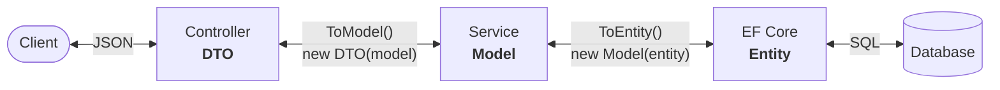

# How it works

Magicalizer does its work in two places: when the application starts, it finds your classes and creates the services
and the controllers for them; when a request comes, it passes it through the layers, from the DTO to the entity and
back.

## At startup

`AddMagicalizer` and the start of ASP.NET Core:

1. **The services.** Each model that implements `IModel<TEntity, TFilter>` gets a service, `IService<TKey, TModel,
   TFilter>`, registered in the dependency injection: the default `Service<...>` or your class that implements this
   interface (usually by deriving from `Service<...>`).
2. **The validators.** Each FluentValidation validator, of a DTO or of a model, is registered.
3. **The controllers.** When ASP.NET Core builds its controllers, each DTO marked with `[Magicalized]` gets one: the
   default `MagicalizedController<...>` or your class derived from it. Its route, HTTP methods, authorization, and
   OpenAPI settings come from the attributes of the DTO.
4. **The diagnostics.** The log tells which DTOs are served, by which controllers, with which methods, and which classes
   are skipped and why.

The generic classes are closed over your types (`MagicalizedController<int, Product, Api.Dto.Product, ProductFilter>`),
so there is no code generation: these are the same controllers and services you would write, only written once. Then
`UseMagicalizer` maps the controllers. See [Type discovery](../building-blocks/type-discovery.md) for the rules of
finding the classes.

## A request

The controller binds and validates the request, the service validates the model and builds the query with the
prefilters, and EF Core runs it.

### Reading a list

`GET /v1/products?category.name.equals=Pizza&sort=-price&limit=10&include=photos`:

1. **The query string is checked.** An unknown parameter or condition is an error, as the response would have the
   objects the client didn’t ask for.
2. **The query is bound.** The conditions fill `ProductFilter`, and `sort` and `include` become the property paths of the
   model, checked against its properties. The `limit` is checked against the maximum one. All the errors go into one
   `400 Bad Request`.
3. **The controller calls the service:** `GetAllAsync(filter, sortings, offset, limit, inclusions)`.
4. **The service builds one query** of EF Core: the [query prefilters](../customization/query-prefilters.md), then the
   filter, the sorting, the paging, and the inclusions. The query doesn’t track the entities.
5. **The entities become the models** by the constructors of the models (`new Product(productEntity)`).
6. **The total count** is a second query with the same prefilters and filter, unless the client or the options skip it.
7. **The models become the DTOs** by the constructors of the DTOs (`new Api.Dto.Product(productModel)`) and are
   serialized to JSON.

The filter, the sorting, and the inclusion are translated by EF Core into SQL, so the database does the filtering, not
the application. The property paths (`category.name`) are the same in the model and the entity, as the filter and the
model follow the properties of the entity.

### Writing

`POST /v1/products` with a JSON body:

1. **The body becomes the DTO**, and the DTO validator checks it with the `Default` and `Create` rule sets (`Edit` for
   `PUT` and `PATCH`). The errors are `400 Bad Request`.
2. **The DTO becomes the model** (`dto.ToModel()`), and the controller calls `CreateAsync` of the service.
3. **The service validates the model** with its own validator, if there is one, the same way.
4. **The model becomes the entity** (`model.ToEntity()`), and EF Core saves it.
5. **If the database rejects it**, the service tells why: a duplicate primary key (`409 Conflict`), a reference to an
   object that doesn’t exist (`400 Bad Request`), or, on deletion, an object other ones refer to (`409 Conflict`).
6. **The saved entity goes back** as the model and the DTO: `201 Created` with the `Location` header.

`PUT`, `PATCH`, and `DELETE` go the same way. They first find the object through the query prefilters, so an object the
prefilters hide is `404 Not Found`, as for reading.

## Why the three layers

Each layer has its own class, so each of them can change without the others:

- the **entity** follows the database (foreign keys like `CategoryId`, columns, navigation properties);
- the **model** follows the business logic and is what the services and your code work with;
- the **DTO** is the contract of the API, which the clients depend on, and it can hide or rename what the model has.

The conversions between them are the plain constructors and methods you write (`ToModel`, `ToEntity`), so there is no
mapping library and no hidden conventions: what you see is what’s converted. See
[Packages and layers](packages-and-layers.md) for how the layers map to the projects.

## See also

- [Type discovery](../building-blocks/type-discovery.md)
- [Endpoints](../http-api/endpoints.md)
- [Errors](../http-api/errors.md)
