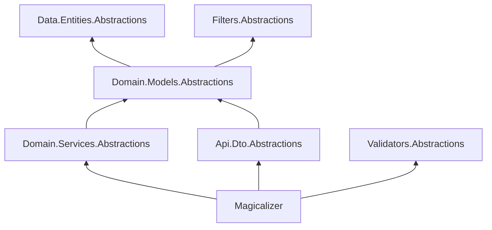

# Packages and layers

Magicalizer is split into seven NuGet packages by the layers, so each project of your solution depends only on the
abstractions of its own layer, and only the web application depends on ASP.NET Core and the implementation.

## The packages

| Package | Contents | Used by |
|---|---|---|
| `Magicalizer` | The controllers, the services, `AddMagicalizer`, and `UseMagicalizer` | The web application, the custom services and controllers |
| `Magicalizer.Api.Dto.Abstractions` | `IDto`, `[Magicalized]`, `[AuthenticatedOnly]`, `[AuthorizedOnly]`, `HttpMethod` | The DTOs |
| `Magicalizer.Domain.Models.Abstractions` | `IModel` | The models |
| `Magicalizer.Domain.Services.Abstractions` | `IService`, `IQueryPrefilter`, the sorting and inclusion, the exceptions of the services | The query prefilters and the code that uses the services |
| `Magicalizer.Data.Entities.Abstractions` | `IEntity` | The entities |
| `Magicalizer.Filters.Abstractions` | `IFilter`, the filters of the values and of the collections, `[IgnoreFilter]` | The filters |
| `Magicalizer.Validators.Abstractions` | `RuleSetName` | The validators |

The abstractions reference each other the way the layers do:



The abstractions target .NET Standard 2.0 and have no dependencies on ASP.NET Core, Entity Framework Core, or
FluentValidation, so they don’t pull a framework into the projects of the entities, models, or DTOs. `Magicalizer`
targets .NET 10 and brings the rest (see [Requirements](requirements.md)).

A package brings the ones it references, so in a single-project application `Magicalizer` is the only package you add.

## A single project

The simplest application is one web project that references `Magicalizer` and keeps the layers in folders and
namespaces, as in [Your first API](../getting-started/your-first-api.md):

```text
App/
  Api/Dto/                 # DTOs and their validators
  Domain/Models/           # Models (and their validators)
  Domain/Services/         # Custom services
  Data/Entities/           # Entities and the DbContext
  Filters/
  Program.cs
```

It’s a good start, and the layers are still apart: a DTO doesn’t touch an entity, and a model doesn’t know about HTTP.

## Separate projects

In a larger solution, the layers become projects, and each of them references only what it needs:

| Project | References |
|---|---|
| `App.Data.Entities` (the entities, the `DbContext`) | `Magicalizer.Data.Entities.Abstractions`, EF Core (`Microsoft.EntityFrameworkCore.Relational`) |
| `App.Filters` | `Magicalizer.Filters.Abstractions` |
| `App.Domain.Models` (the models and their validators) | `Magicalizer.Domain.Models.Abstractions`, `Magicalizer.Validators.Abstractions`, FluentValidation, `App.Data.Entities`, `App.Filters` |
| `App.Domain.Services` (the custom services, the prefilters) | `Magicalizer`, `App.Domain.Models` |
| `App.Api.Dto` (the DTOs and their validators) | `Magicalizer.Api.Dto.Abstractions`, `Magicalizer.Validators.Abstractions`, FluentValidation, `App.Domain.Models` |
| `App` (the web application) | `Magicalizer`, the projects above, the EF Core provider |

Each project explicitly references only its own layer (and the projects it builds on), so, for example, the models
can’t reach the HTTP API. The custom services usually derive from `Service<...>` of the `Magicalizer` package. If a project only has the
query prefilters, `Magicalizer.Domain.Services.Abstractions` is enough for it.

> [!WARNING]
> In a solution of several projects, the assemblies of the DTOs, models, and entities must be loaded when
> `AddMagicalizer` is called, or Magicalizer doesn’t find the classes in them. See
> [A layered solution](../getting-started/layered-solution.md#loading-the-assemblies).

## See also

- [A layered solution](../getting-started/layered-solution.md)
- [How it works](how-it-works.md)
- [Installation](../getting-started/installation.md)
